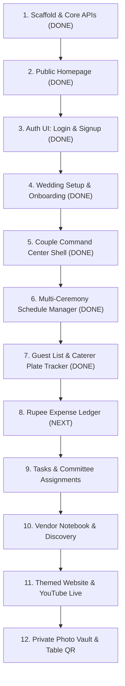
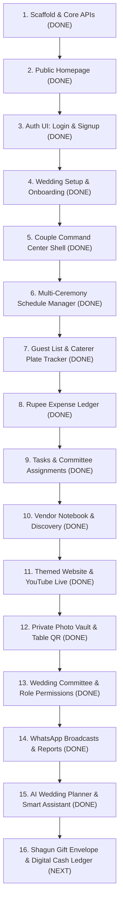

# Make My Marriage — Project Status & Feature Log

**Product:** Make My Marriage  
**Tagline:** *Your Wedding. Your People. Your Plan. All in One Place.*  
**Primary Sub-mark:** *The Operating System for Managing an Indian Wedding*  
**Branch:** `dev`  
**Last Updated:** October 17, 2026  
**Repository Baseline:** Clean, Modular Monolith (Next.js 14 App Router + MongoDB)

---

## 1. High-Level Progress Overview

| Metric | Status | Notes |
|---|---|---|
| **Overall Roadmap Phase** | **Phase 8: AI Intelligence & Automation (In Progress)** | AI Wedding Planner & Halwai Calculator, WhatsApp Broadcasts & Multi-Channel Reports, Wedding Committee Collaborators & Role-Based Permissions, Private Photo Vault, Table QR Standees, Themed Wedding Website, YouTube Live Stream & Google Meet, Vendor Notebook, Tasks & Family Committees, Rupee Ledger, Guests & RSVPs, Schedule Manager, Auth, and Homepage complete |
| **Total Automated Tests** | **357 / 357 Passing** | 43 comprehensive Vitest test suites (+19 new tests) |
| **TypeScript Validation** | **0 Errors** | Strict mode validated (`tsc --noEmit`) |
| **Linting (ESLint)** | **0 Warnings / 0 Errors** | Next.js core Web Vitals & ESLint rules passing |
| **Production Build** | **Success** | Verified pre-rendering of `/`, `/login`, `/signup`, `/onboarding`, `/app`, `/app/ceremonies`, `/app/guests`, `/app/expenses`, `/app/tasks`, `/app/vendors`, `/app/gallery`, `/app/website`, `/app/team`, `/app/broadcasts`, `/app/planner`, `/w/[slug]`, `/gallery/[token]`, `/invite/[token]`, `/member-invitation/[token]` |
| **Dev Server Status** | **Live & Serving** | Running on `http://localhost:3000` |

---

## 2. Completed Major Features

### Feature 1: Project Scaffold & Core Infrastructure
* **Status:** `COMPLETED`
* **Completion Date:** October 15, 2026
* **Description:**  
  Established the foundational modular monolith scaffold adhering to the approved System Design, Database Design, and API Design specifications.
* **Key Deliverables:**
  * **Framework & Tooling:** Next.js 14 App Router, TypeScript strict configuration, Tailwind CSS with customized Indian wedding color tokens (`brand-crimson`, `brand-gold`, `brand-sand`, `brand-ivory`, `brand-emerald`), Vitest testing environment.
  * **Database & Infrastructure:** Mongoose connection pooling with global connection caching for serverless environments, structured logging (`logger.ts`), centralized AppError hierarchy, standardized API response envelopes.
  * **Environment Safety:** Zod-validated environment schema (`env.ts`) with safe `.env.example` and build-phase detection.
  * **Authentication Engine:** Custom session management with bcryptjs password hashing, SHA-256 session token hashing, 30-day expiry, and secure `HttpOnly` cookie management (`mmm_session`).
  * **Core REST APIs:**
    * `POST /api/auth/signup` — User registration and automatic session creation.
    * `POST /api/auth/login` — Credential validation and session token generation.
    * `POST /api/auth/logout` — Server-side session invalidation and cookie clearing.
    * `GET /api/auth/me` — Current user, membership, and wedding resolution.
    * `POST /api/wedding` — Atomic wedding creation, unique slug generation with collision suffixes, creator assigned as `ADMIN`.
    * `GET /api/wedding` & `PATCH /api/wedding` — Tenant-isolated retrieval and updates.
    * `GET /api/health` — System uptime and database connection status check.
* **Verification:** 76 automated tests passing across 9 test files; production build verified.

---

### Feature 2: Public Platform Homepage (`/`)
* **Status:** `COMPLETED`
* **Completion Date:** October 15, 2026
* **Description:**  
  Built a visually rich, culturally grounded, low-text public landing page optimized for Indian couples and families.
* **Key Deliverables:**
  * **Brand Identity & Logo:** Crafted a bespoke luxury vector SVG insignia combining an interlocking ceremonial Gathbandhan knot, lotus crest, and gold foil metallic gradients.
  * **Copy & Tagline Architecture:**
    * Main Heading: *"Your Wedding. Your People. Your Plan. All in One Place."*
    * Eyebrow Tagline: *"The Operating System for Managing an Indian Wedding"*
    * Stacking Sub-mark: *"The Operating System for Indian Weddings"*
  * **Interactive Theme Switcher:** Live preview selector enabling couples to switch between 4 wedding palettes in real time:
    1. 🔴 Royal Crimson & Zari Gold (Auspicious & Regal)
    2. 🟡 Marigold Sunshine & Amber (Haldi & Festive Glow)
    3. 🟢 Regal Emerald & Sandalwood (Palatial Heritage)
    4. 🌸 Pastel Gulabi & Rose Gold (Romantic & Floral)
  * **Interactive Command Center Card:** Live preview card displaying couple details (Divya & Rahul), countdown timer (*42 Days to Go*), ceremony photography thumbnails (Haldi, Mehendi, Sangeet, Pheras, Reception), exact caterer plate counts, and rupee expense tracking.
  * **WhatsApp vs. Make My Marriage Comparison:** Visual 4-row side-by-side contrast highlighting the chaos of scattered chat groups vs. the clarity of a shared workspace.
  * **"Show, Don't Tell" Feature Showcase:** 6 visual cards with photography headers, data chips, and concise 1-sentence explanations.
  * **3-Step Lifecycle Workflow:** Action-oriented preparation phases: *01. CREATE*, *02. COORDINATE*, *03. CELEBRATE*.
  * **Compact 2-Column FAQ & Conversion Banner:** Quick answers for elder accessibility without app downloads, multi-family budgets, and overseas YouTube live streaming.
* **Verification:** 11 unit/component tests in `landing.test.tsx` (87 total tests passing in project); zero lint warnings; zero type errors.

---

### Feature 3: Authentication UI Pages (`/signup` and `/login`)
* **Status:** `COMPLETED`
* **Completion Date:** October 15, 2026
* **Description:**  
  Built accessible, luxury-styled client authentication interfaces for user registration (`/signup`) and session sign-in (`/login`), integrated with backend session management and automated routing.
* **Key Deliverables:**
  * **Shared Luxury Card (`auth-card.tsx`):**
    * Centered royal container featuring the luxury Gathbandhan vector logo insignia and gold metallic wordmark.
    * Dynamic header with context-aware title, subtitle, and trust badges (*256-bit Encrypted* • *Zero Spam* • *Family Privacy First*).
  * **Interactive Signup Form (`signup-form.tsx`):**
    * Name, Email, and Password inputs with show/hide password toggle.
    * Client-side validation for required fields, RFC 5322 email formatting, and minimum 8-character password constraint.
    * Error alert banner handling 409 Conflict (e.g. *"An account with this email already exists"*) and validation feedback.
    * Loading spinner during submission and auto-redirect to `/onboarding` for new users or `/app` for returning users with an existing wedding.
    * Seamless navigation link to `/login`.
  * **Interactive Login Form (`login-form.tsx`):**
    * Email and Password fields with show/hide toggle and accessible label associations.
    * Form submission handling with error alert banner for 401 Unauthorized (*"Invalid email or password"*).
    * Loading state and automatic redirect to `/app` (or `/onboarding` if the user has no workspace).
    * Navigation link to `/signup`.
  * **Route Entry Points:**
    * `src/app/(auth)/signup/page.tsx`: Static page rendering `AuthCard` and `SignupForm`.
    * `src/app/(auth)/login/page.tsx`: Static page rendering `AuthCard` and `LoginForm`.
  * **Automated Unit Tests (`auth-forms.test.tsx`):**
    * 5 unit tests validating AuthCard rendering, SignupForm inputs, LoginForm inputs, and both page components.
* **Verification:** 92 automated tests passing across 11 test suites; zero TypeScript errors; zero ESLint warnings; Next.js static build verified (`○ /login`, `○ /signup`).

---

### Feature 4: Wedding Setup & Onboarding Flow (`/onboarding`)
* **Status:** `COMPLETED`
* **Completion Date:** October 17, 2026
* **Description:**  
  Built a 3-step royal onboarding wizard for newly registered couples to configure their auspicious wedding celebration workspace, integrated directly with `POST /api/wedding` and automatic redirection to the Couple Dashboard (`/app`).
* **Key Deliverables:**
  * **Stepped Royal Wizard (`onboarding-wizard.tsx`):**
    * **Step 1 (The Couple):** Groom Name and Bride Name inputs with instant validation and error highlighting.
    * **Step 2 (Date & City):** Auspicious wedding date picker and wedding city/destination with 1-click popular destination pills (Jaipur, Udaipur, Goa, Delhi NCR, Mumbai, Bengaluru).
    * **Step 3 (Celebration Title & Launch):** Real-time live workspace preview card displaying couple names, date, destination city, and dynamic countdown badge (*"X Days to Go"*), with an optional custom wedding title input.
    * **Progress Step Indicator:** Animated 3-step breadcrumb bar allowing backward navigation to previous steps.
  * **API Integration:**
    * Submits to `POST /api/wedding`, creating the wedding document, generating the unique URL slug (e.g. `/w/rahul-divya-2027`), initializing the private photo vault, and assigning the creator as `ADMIN`.
    * Handles conflict states (409 already has wedding -> forwards to `/app`) and unauthenticated states (401 -> forwards to `/login`).
    * Celebratory success overlay with Shubh Aarambh congratulations banner and automatic transition to `/app`.
  * **Route Page (`src/app/(auth)/onboarding/page.tsx`):**
    * Wrapped in luxury `AuthCard` with the ceremonial Gathbandhan logo, subtitle, and trust badges.
  * **Couple Dashboard Shell (`src/app/(dashboard)/app/page.tsx` & `dashboard-shell.tsx`):**
    * Authenticated command center shell displaying active couple names, date, city, countdown badge, and module cards for upcoming ceremonies, guests, expense ledger, and themed website.
  * **Automated Unit Tests (`onboarding-wizard.test.tsx`):**
    * 3 tests verifying wizard step 1 inputs, onboarding route page rendering, and dashboard shell compilation.
* **Verification:** 95 automated tests passing across 12 test suites; zero TypeScript errors; zero ESLint warnings.

---

### Feature 5: Multi-Ceremony Schedule Manager (`/app/ceremonies`)
* **Status:** `COMPLETED`
* **Completion Date:** October 17, 2026
* **Description:**  
  Built a comprehensive multi-ceremony schedule manager for multi-day Indian weddings with full backend domain modeling, REST APIs, timeline cards, quick presets, and live dashboard integration.
* **Key Deliverables:**
  * **Domain Layer (`src/modules/event/`):**
    * Mongoose model (`event.model.ts`) with tenant isolation (`weddingId`), compound indexes (`{ weddingId: 1, startsAt: 1 }` and `{ weddingId: 1, archivedAt: 1 }`).
    * Zod validation schemas (`event.schema.ts`) for `createEvent`, `updateEvent`, and `queryEvents` enforcing that `endsAt` > `startsAt` and validating standard Indian ceremony presets.
    * Domain service (`event.service.ts`) supporting tenant-isolated `listEvents`, `createEvent`, `getEventById`, `updateEvent`, and soft `archiveEvent`.
  * **REST API Endpoints (`src/app/api/events/`):**
    * `GET /api/events` — Lists ceremonies chronologically (`startsAt ASC`), excluding archived events by default.
    * `POST /api/events` — Creates event with Zod validation (`201 Created`).
    * `GET /api/events/:eventId` — Retrieves single ceremony for authenticated members.
    * `PATCH /api/events/:eventId` — Partially updates event fields with timestamp validation.
    * `DELETE /api/events/:eventId` — Soft-archives the event (`archivedAt = now`), preserving relationships with guests and expenses.
  * **UI Components (`src/components/ceremonies/` & `src/components/dashboard/`):**
    * `DashboardNav`: Universal top and mobile navigation bar linking Command Center and Ceremonies.
    * `CeremonyCard`: Visual card with icon badges (🪔 Haldi, 🌿 Mehendi, 🎵 Sangeet, 🌺 Mandap/Pheras, 🥂 Reception), formatted Indian date & times, venue, address with 1-click Google Maps link, dress code chip, and Edit/Archive actions.
    * `CeremonyModal`: Modal for creating and editing events with 1-click quick presets (Haldi, Mehendi, Sangeet, Wedding, Reception) that auto-fill suggested dress codes and titles.
    * `CeremonyList`: Chronological timeline container with count badge, Add Ceremony button, and rich empty state.
    * `DashboardShell`: Updated to feature clickable Ceremonies management card.
  * **Route Page (`src/app/(dashboard)/app/ceremonies/page.tsx`):**
    * Dedicated route page at `/app/ceremonies` with `DashboardNav` and `CeremonyList`.
  * **Automated Test Coverage:**
    * 8 unit tests in `event.service.test.ts`.
    * 6 route tests in `events.routes.test.ts`.
    * 6 component tests in `ceremony-components.test.tsx`.
* **Verification:** 115 automated tests passing across 15 test suites; zero TypeScript errors; zero ESLint warnings; Next.js dev server live.

---

### Feature 6: Guest List & Caterer Plate Tracker (`/app/guests` and `/invite/:token`)
* **Status:** `COMPLETED`
* **Completion Date:** October 17, 2026
* **Description:**  
  Built an end-to-end guest roster management and caterer plate calculation system with groom vs. bride side segregation, party capacities (Adults + Kids), dietary requirements (Jain, Pure Veg, Non-Veg), individual tokenized invitation links for WhatsApp sharing, and an accountless 1-tap mobile RSVP landing page.
* **Key Deliverables:**
  * **Domain Layer (`src/modules/guest/`):**
    * Mongoose schema (`guest.model.ts`) with tenant isolation (`weddingId`), high-entropy `invitationToken` (`select: false`), and compound indexes (`{ invitationToken: 1 }`, `{ weddingId: 1, rsvpStatus: 1 }`, `{ weddingId: 1, side: 1 }`).
    * Zod validation schemas (`guest.schema.ts`) for create, update, query filters, and public RSVP submissions.
    * Domain service (`guest.service.ts`) with `listGuests`, `createGuest`, `getGuestById`, `updateGuest`, `deleteGuest`, `getGuestInvitationLink`, `getPublicInvitation`, `submitPublicRsvp`, and `getCatererPlateSummary`.
  * **REST API Endpoints:**
    * `GET /api/guests` — Lists guests for wedding with query filters (`side`, `rsvpStatus`, `search`, `dietary`).
    * `POST /api/guests` — Creates guest family with party size and ceremony selections (`201 Created`).
    * `GET /api/guests/:guestId` — Retrieves single guest details.
    * `PATCH /api/guests/:guestId` — Updates guest details and RSVP status.
    * `DELETE /api/guests/:guestId` — Removes guest from wedding roster.
    * `GET /api/guests/:guestId/invitation-link` — Retrieves private tokenized invitation URL and pre-composed WhatsApp message.
    * `GET /api/guests/plate-summary` — Aggregates caterer plate counts, total party capacity, pending count, and dietary distribution (`Pure Veg`, `Jain`, `Non-Veg`).
    * `GET /api/public/invitations/:token` — Public read endpoint returning sanitized wedding details, ceremony agenda, and guest RSVP state.
    * `POST /api/public/invitations/:token/rsvp` — Public 1-tap RSVP endpoint updating attendance status, confirmed headcounts, and dietary preferences.
  * **UI Components & Pages:**
    * `CatererPlateBanner`: Top metric strip calculating confirmed caterer plates, total capacity, pending RSVPs, and dietary badges (🌱 Pure Veg, 🟡 Jain, 🍗 Non-Veg) plus ceremony breakdown.
    * `GuestModal`: Modal for adding/editing guest family, selecting bride/groom side, party size, dietary requirement, private notes, and ceremony invitations.
    * `GuestRoster`: Interactive table with search, side filter tabs (All, Groom's Side, Bride's Side, Mutual), RSVP status badges, and 1-click WhatsApp invite link generator with copy clipboard and direct WhatsApp launch.
    * `PublicInviteCard`: Authentic royal Indian wedding Patrika experience with golden Lord Ganesha emblem, sacred Sanskrit Shloka (`वक्रतुण्ड महाकाय`), gold foil double border, couple regal serif typography, personalized guest parchment scroll (`सादर आमंत्रण`), ceremony itinerary cards (हल्दी, मेहँदी, संगीत, शुभ विवाह, प्रतिभोज) with 1-click Google Maps Navigation & Google Calendar sync, and ceremonial RSVP slip (`प्रतिउत्तर पत्र`) with caterer plate selector and celebratory flower shower (`पुष्प वर्षा`).
    * Route Pages: `/app/guests` (dashboard roster & caterer tracker) and `/invite/[token]` (public frictionless guest RSVP page).
    * Navigation: Integrated `Guests & RSVPs` in `DashboardNav` and linked dashboard overview card to `/app/guests`.
    * Host RSVP Controls: 1-click interactive RSVP dropdown in table (`Pending`, `Attending`, `Declined`), "Open RSVP ↗" direct link in table actions, and RSVP status & confirmed plates editor in `GuestModal`.
  * **Automated Test Coverage:**
    * 7 unit tests in `guest.service.test.ts`.
    * 7 route tests in `guests.routes.test.ts`.
    * 7 component tests in `guest-components.test.tsx`.
* **Verification:** 136 automated tests passing across 18 test suites; zero TypeScript errors; zero ESLint warnings; Next.js dev server live.

---

## 3. Implementation Roadmap & Upcoming Queue

### Feature 7: Rupee Expense Ledger (`/app/expenses`)
* **Status:** `COMPLETED`
* **Completion Date:** October 17, 2026
* **Description:**  
  Built a comprehensive Indian wedding financial ledger tracking total agreed costs, advance token payments (halwai, venue, mandap decor), pending balance dues, category distribution, and multi-family payer splits (Groom, Bride, Joint). All monetary values are strictly stored as integer paise minor units (1 Rupee = 100 Paise) to eliminate floating-point rounding errors.
* **Key Deliverables:**
  * **Domain Constants & Schema:**
    * `EXPENSE_CATEGORIES`: 13 Indian wedding categories (Venue, Catering, Photography, Videography, Decoration, Clothing, Jewellery, Entertainment, Invitations, Gifts, Travel, Makeup, Other).
    * `PAYMENT_STATUS`: `PENDING` (Estimated/Unpaid), `PARTIAL` (Advance Token Paid), `PAID` (Fully Cleared).
    * `PAYER_SIDE`: `GROOM`, `BRIDE`, `SHARED` for multi-family split tracking.
  * **Currency Utilities (`currency.ts`):**
    * `paiseToRupees`, `rupeesToPaise`, `formatRupees` (Indian numbering system format e.g. `₹1,50,000`), and `formatCompactRupees` (`₹1.5 L`, `₹1.25 Cr`).
  * **Data Layer & Service (`expense.model.ts` & `expense.service.ts`):**
    * Mongoose model with integer validators, compound indexes (`weddingId + expenseDate`, `weddingId + category`, `weddingId + paymentStatus`).
    * Full CRUD operations, ceremony event foreign key integrity validation, and `getExpenseSummary` running MongoDB aggregation pipelines for totals, payer distributions, category percentages, and status counts.
  * **REST API Endpoints:**
    * `GET /api/expenses` — Paginated and filtered expense list (search, category, status, payer).
    * `POST /api/expenses` — Create new wedding expense.
    * `GET /api/expenses/summary` — Real-time financial summary aggregations.
    * `GET /api/expenses/:expenseId` — Single expense retrieval.
    * `PATCH /api/expenses/:expenseId` — Update expense and sync payment status.
    * `DELETE /api/expenses/:expenseId` — Hard delete expense.
  * **UI Components & Pages:**
    * `ExpenseMetricStrip`: Top overview cards showing Total Budgeted, Advance Paid with progress bar, Pending Balance Due, multi-family payer split, and visual category spending distribution.
    * `ExpenseModal`: Modal for adding/editing expenses with Rupee input conversion, advance token handling, payer attribution, vendor name, ceremony dropdown, and date picker.
    * `ExpenseLedger`: Full ledger table with live search, filters, quick inline status dropdown, Indian Rupee formatting, and delete confirmation.
    * Route Page: `/app/expenses` integrated into `DashboardNav` and linked from Command Center.
  * **Automated Test Coverage:**
    * 9 unit tests in `expense.service.test.ts`.
    * 4 unit tests in `currency.test.ts`.
    * 6 route tests in `expenses.routes.test.ts`.
    * 7 component tests in `expense-components.test.tsx`.
* **Verification:** 162 automated tests passing across 22 test suites; zero TypeScript errors; zero ESLint warnings; Next.js dev server live.

---

### Feature 8: Tasks Checklist & Family Committee Assignments (`/app/tasks`)
* **Status:** `COMPLETED`
* **Completion Date:** October 17, 2026
* **Description:**  
  Built a comprehensive Indian wedding task checklist and family delegation system. Enables couples and families to coordinate ceremonial duties across 8 cultural committees (Rituals & Puja, Hospitality & Logistics, Catering & Halwai, Attire & Jewellery, Music & Sangeet, Decor & Flowers, Cards & Shagun, General Duties), assign tasks to wedding members or family squads (e.g. "Mama ji's Squad", "Pooja Didi"), track due dates, set priority levels (High, Medium, Low), and toggle completion with live progress calculations.
* **Key Deliverables:**
  * **Domain Constants & Schema (`src/shared/constants/index.ts` & `task.schema.ts`):**
    * `TASK_COMMITTEES`: 8 Indian wedding preparation committees (`RITUALS_PUJA`, `HOSPITALITY_LOGISTICS`, `CATERING_HALWAI`, `ATTIRE_JEWELLERY`, `ENTERTAINMENT_MUSIC`, `DECOR_FLORAL`, `INVITATIONS_GIFTS`, `GENERAL`).
    * `TASK_STATUS`: `TODO`, `IN_PROGRESS`, `COMPLETED`.
    * `TASK_PRIORITY`: `LOW`, `MEDIUM`, `HIGH`.
  * **Data Layer & Service (`task.model.ts` & `task.service.ts`):**
    * Mongoose model with compound indexes (`weddingId + status`, `weddingId + dueDate`, `weddingId + assignedMembershipId + status`, `weddingId + eventId`, `weddingId + committee`).
    * Strict same-wedding foreign key integrity validation on both `assignedMembershipId` and `eventId`.
    * Automatic timestamp management (`completedAt` set when status becomes `COMPLETED`, cleared if reopened).
    * `getTaskSummary` running aggregation pipelines for total counts, completion percentage, high priority urgent counters, and committee breakdowns.
    * `listMembersForAssignment` joining memberships with users to provide real member names.
  * **REST API Endpoints:**
    * `GET /api/tasks` — Filterable and paginated tasks (search, status, priority, committee, eventId, myTasks).
    * `POST /api/tasks` — Create new wedding task.
    * `GET /api/tasks/summary` — Task checklist summary metrics.
    * `GET /api/tasks/members` — List assignable wedding workspace members.
    * `GET /api/tasks/:taskId` — Retrieve single task.
    * `PATCH /api/tasks/:taskId` — Update task details, priority, or toggle status.
    * `DELETE /api/tasks/:taskId` — Hard delete task.
  * **UI Components & Pages:**
    * `TaskMetricStrip`: Header banner with completion progress bar, high-priority urgent badge, assigned duties counter, active committees count, and committee progress pills.
    * `TaskModal`: Modal for adding/editing tasks with committee squad selection, member assignment, ceremony linkage, due date, priority, and status.
    * `TaskChecklist`: Interactive checklist with 4 view tabs (All Tasks, My Assigned Tasks, Pending Action, Completed), search, filters, 1-click completion checkbox with strikethrough, and delete confirmation.
    * Route Page: `/app/tasks` integrated into `DashboardNav` (`📋 Tasks`) and linked from the Command Center (`/app`).
  * **Automated Test Coverage:**
    * 11 unit tests in `task.service.test.ts`.
    * 7 route tests in `tasks.routes.test.ts`.
    * 7 component tests in `task-components.test.tsx`.
* **Verification:** 187 automated tests passing across 25 test suites; zero TypeScript errors; zero ESLint warnings; Next.js dev server live.

---

### Feature 9: Vendor Notebook & Nearby Discovery (`/app/vendors`)
* **Status:** `COMPLETED`
* **Completion Date:** October 17, 2026
* **Description:**  
  Built a comprehensive Indian wedding vendor notebook and location-aware local vendor discovery system. Enables couples and wedding organizers to manage hired wedding professionals across 14 categories (Photographer, Videographer, Venue, Caterer, Decorator, DJ, Makeup Artist, Mehendi Artist, Pandit, Choreographer, Florist, Wedding Planner, Transport, Other), track contact cards with 1-tap phone dialling, store total agreed costs in integer paise (`totalAgreedCostPaise`), link vendors to specific wedding ceremonies, integrate with the Rupee Expense Ledger, and discover top-rated local wedding professionals powered by Google Places with 1-click import into their notebook.
* **Key Deliverables:**
  * **Domain Constants & Schema (`src/shared/constants/index.ts` & `vendor.schema.ts`):**
    * `VENDOR_CATEGORIES`: 14 Indian wedding service categories.
    * `VENDOR_SOURCES`: `MANUAL` and `GOOGLE_PLACES`.
    * Zod validation with rupee-to-paise conversion (`createVendorSchema`, `updateVendorSchema`, `createFromPlaceSchema`, `queryVendorsSchema`, `discoverySearchSchema`).
  * **Data Layer & Service (`vendor.model.ts` & `vendor.service.ts`):**
    * Mongoose model in `vendors` collection with compound indexes (`weddingId + category`, `weddingId + archivedAt`, `weddingId + googlePlaceId`).
    * Strict ceremony foreign key integrity validation across weddings.
    * `getVendorSummary` aggregating total contracted value, ledger disbursements, pending balances, and category breakdown.
    * `createVendorFromPlace` mapping Google Place details with duplicate prevention.
    * Soft delete archiving (`archivedAt`) preserving referential integrity for expenses with optional permanent deletion safeguards.
    * `searchNearbyVendors` location-aware search with curated directory fallback and live `isAdded` status flagging.
  * **REST API Endpoints:**
    * `GET /api/vendors` — Paginated and filterable booked vendors list.
    * `POST /api/vendors` — Create manual vendor.
    * `GET /api/vendors/summary` — Vendor contracted vs paid summary metrics.
    * `POST /api/vendors/from-place` — Import discovered Google Place into booked vendors.
    * `GET /api/vendors/:vendorId` — Retrieve single vendor details.
    * `PATCH /api/vendors/:vendorId` — Update vendor details, contracts, or unarchive.
    * `DELETE /api/vendors/:vendorId` — Soft archive vendor (or hard delete if `?permanent=true`).
    * `GET /api/vendor-discovery/search` — Discover nearby local wedding vendors by category and city.
  * **UI Components & Pages:**
    * `VendorMetricStrip`: Displays Booked Vendors count, Total Contracted amount, Paid from Ledger, Pending Balance due, and category coverage pills.
    * `VendorCard`: Luxury vendor card with category pill, Google rating stars/reviews, contact person, 1-tap call/email, Google Maps directions, agreed contract, ledger disbursement progress bar, contracted ceremony chips, and contract notes.
    * `VendorModal`: Modal for adding or editing vendors with ceremony multi-select and rupee cost conversion.
    * `VendorDiscovery`: Interactive marketplace view for finding local wedding vendors in the wedding city (e.g. Indore) with category filters, search, and 1-click "Add to My Vendors".
    * `VendorNotebook`: 2-tab interface switching between "My Booked Vendors" and "Discover Nearby Vendors".
    * Route Page: `/app/vendors` integrated into `DashboardNav` (`🤝 Vendors`) and Command Center (`/app`).
  * **Automated Test Coverage:**
    * 13 unit tests in `vendor.service.test.ts`.
    * 9 route tests in `vendors.routes.test.ts`.
    * 7 component tests in `vendor-components.test.tsx`.
* **Verification:** 216 automated tests passing across 28 test suites; zero TypeScript errors; zero ESLint warnings; Next.js static build verified.

---

### Feature 10: Themed Wedding Website & Live Streaming (`/w/:slug` & `/app/website`)
* **Status:** `COMPLETED`
* **Completion Date:** October 17, 2026
* **Description:**  
  Built a luxury public hosted wedding website for couples and their guests (`/w/:slug`), accompanied by a dashboard website management suite (`/app/website`). Couples can select from 4 culturally grounded Indian wedding themes (Royal Crimson & Zari Gold, Marigold Sunshine & Amber, Regal Emerald & Sandalwood, Pastel Gulabi & Rose Gold), craft a personalized welcome story, choose between **YouTube Live Stream broadcast** or **Google Meet Virtual Ceremony Room** for NRI and overseas relatives, showcase their complete ceremonial itinerary with Google Maps directions, and enable 1-tap WhatsApp RSVP attendance confirmations.
* **Key Deliverables:**
  * **Theme Architecture & Styles (`website-theme-styles.ts`):**
    * 4 Indian wedding aesthetic palettes with custom background gradients, ceremonial borders, heading hues, and swatch identifiers (`crimson`, `marigold`, `emerald`, `gulabi`).
    * Robust YouTube video ID extraction supporting standard watch, youtu.be, live, and embed URLs.
    * Google Meet utilities (`extractGoogleMeetCode`, `normalizeGoogleMeetUrl`) supporting 10-letter meeting codes (`abc-defg-hij`) and full meet URLs.
  * **Data Layer & Service Methods (`wedding.service.ts` & `wedding.schema.ts`):**
    * `getWebsiteSettings`: Retrieves current slug, theme, published status, and welcome message.
    * `updateWebsiteSettings`: Validated updates with Zod schema for theme, message, and publish toggle.
    * `getLivestreamSettings` & `updateLivestreamSettings`: Manages streaming provider (`YOUTUBE` or `GOOGLE_MEET`), YouTube URL, Google Meet URL/code, host family instructions, and enabled toggle.
    * `getPublicWeddingBySlug`: Non-authenticated tenant retrieval resolving wedding details, ceremonies, gallery status, and livestream config. Includes draft preview mode support for logged-in organizers.
  * **REST API Endpoints:**
    * `GET /api/wedding/website` — Authenticated website settings retrieval.
    * `PATCH /api/wedding/website` — Authenticated website customization and publish toggle.
    * `GET /api/wedding/livestream` — Authenticated livestream status, provider, and room URLs.
    * `PATCH /api/wedding/livestream` — Authenticated livestream updates (YouTube or Google Meet).
    * `GET /api/public/weddings/:slug` — Public endpoint returning published wedding site payload.
  * **Public Website Page (`/w/[slug]` & `WeddingWebsiteView`):**
    * Ganesh Shloka header: *॥ श्री गणेशाय नमः ॥*
    * Dynamic luxury hero with couple monogram, auspicious date in Indian format, destination city, and live countdown timer (*"X Days to Go"* / *"Celebrating Today!"*).
    * Welcome card and couple love story.
    * Ceremonies itinerary with IST timings, venue details, dress code chips, and Google Maps directions link.
    * **Dual Virtual Attendance Modes:**
      * **🔴 YouTube Live Broadcast:** Responsive 16:9 embedded player with pulsing red *LIVE* badge, scheduled broadcast time badge, and direct YouTube app link.
      * **🟢 Google Meet Virtual Room:** Dedicated *Virtual Baithak* card with active green beacon, meeting code display, host family instructions/etiquette banner, scheduled ceremony time in IST, dynamic live countdown badge (*"Starts in X hours"* / *"Happening Now! 🔴"*), 1-tap *Join Google Meet Room ↗* action, link copy button, and 1-tap *Share on WhatsApp* forwarding.
    * 1-Tap WhatsApp RSVP button with pre-filled auspicious blessings.
    * Private draft preview banner for authenticated organizers when unpublished.
  * **Dashboard Website Manager (`/app/website` & `WebsiteManager`):**
    * Interactive theme switcher with visual swatches.
    * Welcome message editor.
    * Dual-provider selector tabs (🔴 YouTube Live vs 🟢 Google Meet).
    * Scheduled ceremony time picker with 1-click auto-fill pills loaded directly from the wedding ceremonies itinerary.
    * Real-time guest preview badge showing the exact countdown guests will see.
    * Live streaming preview for YouTube and real-time meeting test link for Google Meet.
    * Publication visibility toggle with live status badge.
    * Direct link sharing tools: "View Live Website", "Copy Link", and "Share on WhatsApp".
  * **Automated Test Coverage:**
    * 9 unit tests in `wedding.website.test.ts`.
    * 6 route tests in `website.routes.test.ts`.
    * 21 component and utility tests in `website-components.test.tsx`.
* **Verification:** 252 automated tests passing across 31 test suites; zero TypeScript errors; zero ESLint warnings; Next.js dev server live.

### Feature 11: Private Photo Vault & Table QR Code Sharing (`/gallery/:token` & `/app/gallery`)
* **Status:** `COMPLETED`
* **Completion Date:** October 17, 2026
* **Description:**  
  Built a private, high-resolution wedding photo vault and dinner table QR standee sharing system. Organizers can manage ceremony albums, review guest contributions, and print luxury gold-foiled table standee cards for reception banquet tables. Guests can scan table standees using their native smartphone camera and contribute candid memories directly without installing an app or registering an account.
* **Key Deliverables:**
  * **Domain Layer & Schema (`photo.model.ts` & `photo.schema.ts`):**
    * `PhotoModel` with tenant isolation (`weddingId`), ceremony linking (`eventId`), uploader tags (`MEMBER` vs `GUEST`), photo dimensions, captions, and status (`READY`, `PENDING`, `DELETED`).
    * Compound listing indexes: `{ weddingId: 1, status: 1, createdAt: -1 }` and `{ weddingId: 1, status: 1, eventId: 1, createdAt: -1 }`.
    * Unique constraint on `objectKey`.
    * Zod validation schemas for gallery settings updates, cursor pagination, and guest upload metadata.
  * **QR Code Engine (`qr-code.ts`):**
    * Pure TypeScript, zero-dependency QR code generator (`generateQRMatrix` & `generateQRSVG`) using Reed-Solomon polynomial error correction over Galois Field GF(256).
    * Generates crisp, scalable, high-contrast SVGs formatted for tabletop printing and mobile camera scanning.
  * **Domain Service (`photo.service.ts`):**
    * `getGallerySettings`: Retrieves gallery configuration and backfills high-entropy sharing tokens.
    * `updateGallerySettings`: Manages public visibility, guest uploads toggle, and token rotation.
    * `listPhotos`: High-performance cursor pagination with ceremony filtering and aggregate metrics (total count, guest count, member count, total bytes).
    * `uploadPhoto` & `uploadGuestPhoto`: Strict MIME validation (JPEG, PNG, WebP) and 10 MiB limit checks; persists files to storage and creates ready records.
    * `deletePhoto`: Tombstones records and unlinks storage assets.
    * `getPublicGalleryByToken` & `listPublicPhotosByToken`: Token-based unauthenticated guest access with privacy and ceremony resolution.
  * **REST API Endpoints:**
    * `GET /api/gallery/settings` — Authenticated settings retrieval.
    * `PATCH /api/gallery/settings` — Authenticated settings and token management.
    * `GET /api/photos` — Authenticated organizer photo feed with cursor pagination.
    * `POST /api/photos/upload` — Authenticated multi-file photo uploads.
    * `DELETE /api/photos/:photoId` — Authenticated photo deletion.
    * `GET /api/public/galleries/:token` — Public guest gallery metadata by unguessable token.
    * `GET /api/public/galleries/:token/photos` — Public guest photo feed with ceremony album filters.
    * `POST /api/public/galleries/:token/upload` — Public guest photo upload without login.
  * **UI Components & Pages:**
    * `GalleryMetricStrip`: Displays Total Memories count, Guest Contributions, Family Uploads, and Storage Used.
    * `TableQRCardModal`: Interactive modal with SVG QR code, 1-click "Print Table Standee" (formatted for 5x7 / A5 tabletop cards), Copy Guest Link, WhatsApp sharing, and privacy toggles.
    * `UploadPhotoModal`: Modal supporting multi-file selection, ceremony tagging, captions, and guest name attribution.
    * `PhotoGrid`: Responsive masonry layout with hover zoom, ceremony badges, uploader chips, and pagination.
    * `PhotoLightbox`: Fullscreen preview with high-res download, metadata, keyboard navigation, and deletion controls.
    * `GalleryManager`: Complete command view at `/app/gallery` integrated into `DashboardNav` (`📸 Photo Vault`) and Command Center (`/app`).
    * `PublicGalleryView`: Mobile-first public guest portal at `/gallery/:token` with floating upload FAB.
  * **Automated Test Coverage:**
    * 14 unit tests in `photo.service.test.ts`.
    * 6 route tests in `gallery.routes.test.ts`.
    * 11 component and QR tests in `gallery-components.test.tsx`.
* **Verification:** 283 automated tests passing across 34 test suites; zero TypeScript errors; zero ESLint warnings; Next.js dev server live.

### Feature 12: Wedding Committee Collaborators & Role-Based Permissions (`/app/team`)
* **Status:** `COMPLETED`
* **Completion Date:** October 17, 2026
* **Description:**  
  Built a comprehensive team management and role-based access control system allowing couples and organizers to invite family members, committee heads, bridesmaids, groomsmen, and planners to collaborate on their wedding celebration with strict role-based capabilities (`ADMIN` vs `MANAGER`).
* **Key Deliverables:**
  * **Data Layer & Security Rules:**
    * `MemberInvitationModel` (`wedding_member_invitations`) capturing tenant isolation (`weddingId`), invitee email, normalized email, role (`ADMIN` | `MANAGER`), high-entropy unguessable token, token hash, 7-day expiry, and lifecycle statuses (`PENDING`, `ACCEPTED`, `REVOKED`).
    * Compound query indexes: `{ weddingId: 1, status: 1 }` and `{ weddingId: 1, emailNormalized: 1, status: 1 }`.
    * Last Admin Protection: Weddings must always retain at least one `ADMIN`. The system strictly prohibits demoting or removing the final administrator (`LAST_ADMIN` error).
    * Tenant Isolation & Single-Wedding Constraint: Users are bound to a single wedding workspace in V1 (`ALREADY_HAS_WEDDING` error).
    * Email Matching Enforcement: Collaborators can only accept invitations if signed in with the exact invited email address (`INVITATION_EMAIL_MISMATCH` error).
  * **Domain Service (`member.service.ts`):**
    * `listMembers`: Populates member user profiles with emails, names, roles, and join dates.
    * `createInvitation`: Generates cryptographically secure unguessable tokens, ensures no duplicates or active member re-invites.
    * `listInvitations`: Retrieves active pending invitations with formatted direct acceptance URLs.
    * `revokeInvitation`: Immediately revokes pending collaborator access.
    * `updateMemberRole`: Updates collaborator role between `ADMIN` and `MANAGER` with last-admin guard.
    * `removeMember`: Removes collaborator from wedding workspace with last-admin guard.
    * `getPublicInvitationByToken`: Resolves couple and wedding metadata for public invitation screen.
    * `acceptInvitation`: Verifies token, email match, and single-wedding rule, atomically binds user to wedding workspace.
  * **REST API Endpoints:**
    * `GET /api/members` — Lists active committee members (accessible by Admins and Managers).
    * `PATCH /api/members/:membershipId` — Updates member role (Admin only).
    * `DELETE /api/members/:membershipId` — Removes member from celebration (Admin only).
    * `GET /api/members/invitations` — Lists pending invitations (Admin only).
    * `POST /api/members/invitations` — Generates collaborator invitation (Admin only, status 201).
    * `DELETE /api/members/invitations/:invitationId` — Revokes pending invitation (Admin only).
    * `GET /api/public/member-invitations/:token` — Public invitation preview without authentication.
    * `POST /api/member-invitations/:token/accept` — Authenticated invitation acceptance and workspace join.
  * **Organizer UI (`/app/team`):**
    * `TeamMetricStrip`: Metric cards for Total Committee, Admins, Managers, and Pending Invites.
    * `InviteMemberModal`: Interactive dialog with email validation, role cards with privilege descriptions, copy invite link, and 1-click WhatsApp invitation sharing.
    * `MemberList`: Member cards with initials, names, emails, role badges (`👑 ADMIN` / `🛡️ MANAGER`), role switcher dropdown, and remove actions with last-admin protection.
    * `PendingInvitationsList`: Real-time cards showing days until expiry, 1-click WhatsApp share, copy link, and revoke actions.
    * `TeamManager`: Parent controller with search filter, tabbed interface, and informative notice for Managers regarding their read-only permissions on team management.
    * `PublicMemberInvitationView` (`/member-invitation/:token`): Public landing page displaying couple names, ceremony date, assigned role privileges, login/register prompts, and 1-click "Accept & Enter Wedding Workspace".
  * **Navigation Updates:**
    * Added `👥 Team` to `DashboardNav` desktop and mobile navbars.
    * Added `👥 Committee & Roles` module card to Command Center (`DashboardShell`).
  * **Automated Test Coverage:**
    * 19 unit tests in `member.service.test.ts`.
    * 11 route tests in `members.routes.test.ts`.
    * 10 component tests in `team-components.test.tsx`.
* **Verification:** 323 automated tests passing across 37 test suites; zero TypeScript errors; zero ESLint warnings; Next.js dev server live.

### Feature 13: WhatsApp Broadcasts & Multi-Channel Reports (`/app/broadcasts`)
* **Status:** `COMPLETED`
* **Completion Date:** October 17, 2026
* **Description:**  
  Built a comprehensive WhatsApp broadcast messaging suite and export hub for Indian wedding organizers, enabling 1-click personalized WhatsApp message dispatching across guest segments (RSVP nudges, ceremony itineraries, photo vault invitations, livestream links) and instant UTF-8 BOM CSV/Excel report downloads for coordinators and caterers.
* **Key Deliverables:**
  * **Phone Normalization & CSV Engine:**
    * `normalizeWhatsAppPhone` & `formatPhoneDisplay` (`phone.ts`): Sanitizes all phone number formats, prepends `91` country code for 10-digit Indian numbers, and formats clean links for WhatsApp deep-linking (`https://api.whatsapp.com/send?phone=...&text=...`).
    * `escapeCSVCell` & `buildCSV` (`csv.ts`): RFC 4180 compliant CSV generator with UTF-8 Byte Order Mark (`\uFEFF`) ensuring flawless display in Microsoft Excel, Google Sheets, and Apple Numbers without character corruption on Hindi or Rupee symbols.
  * **Domain Service (`broadcast.service.ts`):**
    * `getBroadcastRecipients`: Queries guests with granular segment filtering (`RSVP_STATUS`, `GUEST_SIDE`, `eventId`), personalizes message templates substituting dynamic variables (`{{guestName}}`, `{{coupleNames}}`, `{{weddingDate}}`, `{{rsvpUrl}}`, `{{ceremoniesList}}`, `{{galleryUrl}}`, `{{websiteUrl}}`), and generates WhatsApp deep-links.
    * `generateGuestManifestCSV`: Comprehensive manifest with summary metrics (total invited, confirmed headcount, pending, pure veg, jain, non-veg plates), family grouping, and ceremony assignments.
    * `generateItineraryCSV`: Chronological run-sheet of all wedding events with venues, start/end times, and dress codes.
    * `generateCateringSummaryCSV`: Ceremony-by-ceremony plate count breakdown by dietary type (Pure Veg, Jain, Non-Veg) including a recommended +10% halwai safety buffer.
  * **REST API Endpoints:**
    * `POST /api/broadcasts/recipients` — Generates personalized message previews for filtered guests.
    * `GET /api/broadcasts/export/guests` — Direct download of Guest RSVP Manifest CSV.
    * `GET /api/broadcasts/export/itinerary` — Direct download of Ceremony Logistics Run-Sheet CSV.
    * `GET /api/broadcasts/export/catering` — Direct download of Halwai & Catering Plate Orders CSV.
  * **Organizer UI (`/app/broadcasts`):**
    * `BroadcastMetricStrip`: Metric cards for Target Audience, WhatsApp Ready, Pending RSVPs, and Attending Headcount.
    * `WhatsAppBroadcastComposer`: 5 Indian wedding templates (RSVP Reminder, Ceremony Guide, Photo Vault, Virtual Stream, Custom Note), audience filters, variable insertion pills, and a live dark-mode **WhatsApp Chat Simulator** with message bubble and `✓✓` blue checkmarks.
    * `BroadcastRecipientTable`: Interactive table with 1-click "Send WhatsApp" launcher, session sent tracking (`✓ Sent`), copy message button, and search filtering.
    * `ExportCenterCard`: 3 download cards for Guest Manifest, Ceremony Itinerary, and Catering Plate Orders.
    * `BroadcastManager`: Master controller managing real-time filtering, tabs, and clipboard toast feedback.
  * **Navigation Updates:**
    * Added `📢 Broadcasts` to `DashboardNav`.
    * Added `📢 WhatsApp Broadcasts` module card to Command Center (`DashboardShell`).
    * Added `📢 WhatsApp Broadcasts` shortcut button in the Guest Roster header (`/app/guests`).
  * **Automated Test Coverage:**
    * 6 unit tests in `broadcast.service.test.ts`.
    * 4 route tests in `broadcasts.routes.test.ts`.
    * 5 component tests in `broadcast-components.test.tsx`.
* **Verification:** 338 automated tests passing across 40 test suites; zero TypeScript errors; zero ESLint warnings; Next.js dev server live.

---

### Feature 14: AI Wedding Planner & Smart Assistant (`/app/planner`)
* **Status:** `COMPLETED`
* **Completion Date:** October 17, 2026
* **Description:**  
  Built an AI wedding planning suite and halwai food-wastage optimization engine tailored specifically for Indian weddings. Features an interactive catering plate and wholesale raw material (ration fard) calculator, 6 authentic regional cultural ceremony schedulers (Punjabi, Marwari, Gujarati, South Indian, Maharashtrian, Bengali) with sacred samagri checklists and 1-click workspace import, live budget optimization against Indian wedding benchmark allocations, and a 24/7 intelligent wedding advisor.
* **Key Deliverables:**
  * **Halwai & Catering Plate Optimizer Engine:**
    * Mathematical model factoring in ceremony turnout profiles (e.g. Sangeet 95%, Pheras 88%, Reception 98%, Mehendi 75%) and custom turnout overrides.
    * Safety buffer calculation (+8% to +14%) preventing food shortages while eliminating caterer over-billing.
    * Raw Material (Ration Fard) Estimator: Calculates precise wholesale market quantities for Pure Desi Ghee (A2), Fresh Malai Paneer, Aged Basmati Rice, Atta & Maida, Milk & Khoya, Cooking Oil, Dal, and Mithai gift boxes.
    * Real-time Rupee savings calculation against flat blind caterer quotes.
  * **Regional Cultural Ceremony Schedulers:**
    * 6 complete regional wedding traditions:
      1. *North Indian / Punjabi*: Mehendi, Jaggo & Sangeet Night, Haldi & Chooda Kalire, Baraat & Vedic Pheras, Reception.
      2. *Marwari / Rajasthani*: Bhaat Nyootna (Mayra), Tel Baan & Haldi, Sangeet & Ghoomar, Korath & Royal Pheras.
      3. *Gujarati*: Mandap Mahurat & Grah Shanti, Mameru / Mosalu, Sanji & Dandiya Raas, Jaan Aagman & Hastamelap.
      4. *South Indian*: Vratham & Nandi Pooja, Mangala Snanam, Kasi Yatra & Oonjal, Kanyadaanam & Mangalya Dharanam.
      5. *Maharashtrian*: Kelvan, Halad Chadavane, Simant Pujan & Antarpat, Saptapadi & Kanyadaan.
      6. *Bengali*: Gaye Holud & Tattva, Dodhi Mangol, Bor Boron & Saat Paake Ghaura, Sindoor Daan & Bou Bhaat.
    * Authentic sacred Samagri checklists (e.g. Manek Stambha, Mundavalya, Shankha, Antarpat, Hawan Samagri).
    * 1-Click "Import Ceremonies to Schedule": Atomically adds missing events to `WeddingEventModel` and essential duties to `TaskModel`.
  * **AI Budget Optimizer:**
    * Compares live expenses from `ExpenseModel` against industry benchmarks across couple priorities (`BALANCED`, `FOOD_FOCUSED`, `DECOR_PHOTO`, `INTIMATE_LUXURY`).
    * Computes category status (`HEALTHY`, `NEARING_LIMIT`, `OVER_BUDGET`), budget health score (0-100), and specific negotiation strategies.
  * **Planner Advisor AI Engine:**
    * Heuristic advisory engine providing answers to common dilemmas: Halwai grocery lists, Mandap samagri checklists, Groom vs Bride expense splitting, and wedding season bargaining.
  * **REST API Endpoints:**
    * `POST /api/ai-planner/halwai` — Calculates optimal plates and wholesale ration fard.
    * `GET /api/ai-planner/cultural-presets` — Lists 6 regional cultural presets and ceremonies.
    * `POST /api/ai-planner/cultural-presets/apply` — 1-click imports preset ceremonies and tasks.
    * `POST /api/ai-planner/budget-optimizer` — Analyzes wedding budget allocations against live ledger.
    * `POST /api/ai-planner/advisor` — Answers wedding planning dilemmas with actionable insights.
  * **Organizer UI (`/app/planner`):**
    * `PlannerMetricStrip`: Displays Catering Savings, Budget Health Score, Ceremonies Mapped, and Advisor Engine.
    * `HalwaiCalculator`: Interactive plate optimizer with turnout sliders, financial summary, and copyable Halwai ration fard.
    * `CulturalScheduler`: Cultural tradition cards, chronological ritual timeline, samagri pills, and 1-click import button.
    * `BudgetOptimizer`: Target budget slider, quick presets, category progress bars, and cost-cutting tips.
    * `PlannerAdvisor`: Prompt suggestions, custom question input, executive summary, and actionable checklist items.
    * `PlannerManager`: Master tabbed controller.
  * **Navigation Updates:**
    * Added `🤖 AI Planner` to `DashboardNav`.
    * Added `AI Planner & Halwai` card to Command Center (`DashboardShell`).
  * **Automated Test Coverage:**
    * 9 unit tests in `ai-planner.service.test.ts`.
    * 5 route tests in `ai-planner.routes.test.ts`.
    * 5 component tests in `planner-components.test.tsx`.
* **Verification:** 357 automated tests passing across 43 test suites; zero TypeScript errors; zero ESLint warnings; Next.js dev server live.

---

## 3. Implementation Roadmap & Upcoming Queue

### Upcoming Feature Details

#### **Step 7.2: Shagun Digital Envelope & Gift Tracking Ledger — NEXT IN LINE**
* **Status:** `READY FOR IMPLEMENTATION`
* **Scope:**
  * Track incoming Shagun cash gifts and physical presents received during ceremonies (Reception, Milni, Pheras).
  * Record cash gift amounts, giver family names, return shagun reciprocity history, and thank-you WhatsApp messages.
  * Instant UPI QR code generator for modern guests wishing to transfer Shagun digitally.

---

## 4. Maintenance Protocol

To maintain complete transparency and continuous context across iterations:
1. **Mandatory Logging:** Whenever a new feature or major milestone is completed, this file (`docs/PROJECT_STATUS.md`) **MUST** be updated with:
   * The feature's name and status (`COMPLETED`).
   * Summary of deliverables, components, and API routes created.
   * Total test count and verification outcomes.
   * Updating the "Next In Line" roadmap item.
2. **Strict Scope Discipline:** Never start a new feature without first verifying that the previous feature is fully logged and verified.

